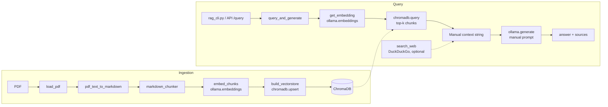
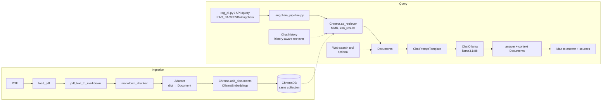

# LangChain Integration — Detailed Implementation Plan

> Status: **Proposed** · Owner: _TBD_ · Target: Roadmap item "LangChain Integration"
> Scope: Refactor the current custom RAG pipeline (`src/rag/`) to run on top of
> [LangChain](https://python.langchain.com/) while keeping the CLI, FastAPI and
> ChromaDB store backward-compatible.

---

## 1. Motivation

The current pipeline uses **direct Ollama API calls** and hand-written retrieval +
prompt-assembly logic in [`src/rag/vectorstore.py`](../src/rag/vectorstore.py)
(`query_vectorstore`, `query_and_generate`) and
[`src/rag/embeddings.py`](../src/rag/embeddings.py) (`get_embedding`, `embed_chunks`).

LangChain gives us, with far less custom code:

- **Pre-built RAG chains** (retrieval + generation) via LCEL / `create_retrieval_chain`.
- **Memory management** for conversational, multi-turn context.
- **Standardized interfaces** for LLMs, embeddings and vector stores (swap models/DBs without rewrites).
- **Advanced retrieval** — multi-query, contextual compression, MMR, re-ranking.
- **Agent capabilities** for complex reasoning (e.g. deciding when to call web search).
- **Prompt templates** for consistent, testable prompt control.
- **Streaming & callbacks** out of the box.

**Trade-offs / risks**

| Concern | Notes / mitigation |
|---|---|
| Added dependencies | `langchain-core`, `langchain-ollama`, `langchain-chroma`, `langchain-community`. Pin versions in `pyproject.toml`. |
| API churn | LangChain evolves fast. Pin exact versions; isolate it behind our own thin wrapper module so swaps are cheap. |
| Store compatibility | Existing `chroma_db/` was written by raw `chromadb`. LangChain's `Chroma` wrapper must read the **same collection + embedding dim**. See §6. |
| Hidden behavior | Chains abstract prompt assembly. Keep prompts explicit via `ChatPromptTemplate`. |
| Complexity | Medium refactor — do it incrementally behind a feature flag (§8). |

---

## 2. Current vs. Target Architecture

### Current (custom)

```
rag_cli.py / api/routes/query.py
        │
        ▼
query_and_generate()  ── get_embedding() ──► ollama.embeddings
        │              ── chromadb.query()
        │              ── manual context string assembly
   │
        ▼
   answer (+ sources)
```

**Mermaid flowchart — without LangChain (current)**



### Target (LangChain)

```
rag_cli.py / api/routes/query.py
        │
        ▼
src/rag/langchain_pipeline.py
   ├─ OllamaEmbeddings(model="nomic-embed-text")
   ├─ Chroma(collection_name, persist_directory, embedding_function)
   │     └─ .as_retriever(search_type="mmr", k=n_results)
   ├─ ChatOllama(model="llama3.1:8b")
   ├─ ChatPromptTemplate (RAG prompt)
   └─ create_retrieval_chain( retriever, create_stuff_documents_chain(llm, prompt) )
        │
        ▼
   {"answer": ..., "context": [Document, ...]}  →  mapped to our (answer, sources)
```

**Mermaid flowchart — with LangChain (target)**



Key idea: **introduce one new module** (`src/rag/langchain_pipeline.py`) that mirrors
the public contract of today's `query_and_generate()` / `embed_chunks()` so callers
(CLI + API) change minimally.

---

## 3. Dependencies

Add to `pyproject.toml` (`uv add ...`) — use the split packages, not the monolithic `langchain`:

```toml
dependencies = [
    # ...existing...
    "langchain-core>=0.3.0",
    "langchain-ollama>=0.2.0",      # OllamaEmbeddings, ChatOllama
    "langchain-chroma>=0.1.4",      # Chroma vector store wrapper
    "langchain-community>=0.3.0",   # misc loaders / utilities (web search tool)
]
```

> Run `uv add langchain-core langchain-ollama langchain-chroma langchain-community`
> so `uv.lock` + `requirements.txt` stay in sync. Verify no CVEs before committing.

---

## 4. Component Mapping (what replaces what)

| Current code | LangChain replacement | Notes |
|---|---|---|
| `get_embedding()` / `embed_chunks()` | `OllamaEmbeddings` | Same model `nomic-embed-text`. LangChain `Chroma.add_documents` embeds internally. |
| `build_vectorstore()` (raw `chromadb.upsert`) | `Chroma.from_documents` / `Chroma.add_documents` | Keep `doc_id`-namespaced IDs to preserve idempotent per-doc upsert (§6). |
| `query_vectorstore()` | `Chroma(...).as_retriever()` | Supports `similarity`, `mmr`, score thresholds. |
| manual prompt string | `ChatPromptTemplate.from_messages([...])` | Explicit system + human prompt. |
| `ollama.generate()` | `ChatOllama` | Streaming-capable. |
| `query_and_generate()` | `create_retrieval_chain(...)` (LCEL) | Returns `{"answer", "context"}`. |
| `search_web()` | LangChain `Tool` / `DuckDuckGoSearchRun` or keep existing fn | Can stay as-is initially; later wrap as a tool for agent routing. |
| interactive loop state | `RunnableWithMessageHistory` / `ConversationBufferWindowMemory` | Enables multi-turn follow-ups. |

---

## 5. Target Module Design

New file: `src/rag/langchain_pipeline.py`

```python
"""LangChain-based RAG pipeline (parallel to the custom vectorstore module)."""

from langchain_ollama import OllamaEmbeddings, ChatOllama
from langchain_chroma import Chroma
from langchain_core.prompts import ChatPromptTemplate
from langchain_core.documents import Document
from langchain.chains import create_retrieval_chain
from langchain.chains.combine_documents import create_stuff_documents_chain

DEFAULT_EMBED_MODEL = "nomic-embed-text"
DEFAULT_GENERATION_MODEL = "llama3.1:8b"

RAG_PROMPT = ChatPromptTemplate.from_messages([
    ("system",
     "You answer strictly from the provided context. "
     "If the answer is not in the context, say you don't know. "
     "Be concise and direct.\n\nContext:\n{context}"),
    ("human", "{input}"),
])


def get_vectorstore(collection_name="product_docs", persist_dir="./chroma_db",
                    embed_model=DEFAULT_EMBED_MODEL) -> Chroma:
    return Chroma(
        collection_name=collection_name,
        persist_directory=persist_dir,
        embedding_function=OllamaEmbeddings(model=embed_model),
    )


def build_vectorstore_lc(docs, collection_name="product_docs",
                         persist_dir="./chroma_db", doc_id=None,
                         embed_model=DEFAULT_EMBED_MODEL):
    """docs: List[Document]. IDs kept as f'{doc_id}_chunk_{i}' for idempotent upsert."""
    vs = get_vectorstore(collection_name, persist_dir, embed_model)
    ids = [f"{doc_id}_chunk_{i}" for i in range(len(docs))] if doc_id else None
    vs.add_documents(docs, ids=ids)
    return vs


def query_and_generate_lc(query_text, collection_name="product_docs",
                          persist_dir="./chroma_db", n_results=5,
                          embed_model=DEFAULT_EMBED_MODEL,
                          generation_model=DEFAULT_GENERATION_MODEL,
                          use_web_search=False, return_sources=False):
    vs = get_vectorstore(collection_name, persist_dir, embed_model)
    retriever = vs.as_retriever(search_type="mmr", search_kwargs={"k": n_results})

    llm = ChatOllama(model=generation_model, temperature=0)
    doc_chain = create_stuff_documents_chain(llm, RAG_PROMPT)
    chain = create_retrieval_chain(retriever, doc_chain)

    result = chain.invoke({"input": query_text})
    answer = result["answer"]

    if return_sources:
        sources = [
            {"text": d.page_content,
             "heading": d.metadata.get("heading", ""),
             "distance": d.metadata.get("score")}  # see §6 on scores
            for d in result["context"]
        ]
        return answer, sources
    return answer
```

> Web search: for phase 1, keep calling the existing `search_web()` and append its
> results into the context (as today). Phase 3 upgrades it to an agent/tool.

---

## 6. ChromaDB Compatibility (critical)

The existing `chroma_db/` was populated by raw `chromadb` in `build_vectorstore()`.
To let LangChain's `Chroma` read it **without re-ingesting**:

1. **Same embedding model & dimension** — must stay `nomic-embed-text` (768-dim).
   A different model → dimension mismatch → errors (already called out in the README troubleshooting).
2. **Same collection name** (`product_docs`) and `persist_directory` (`./chroma_db`).
3. **Metadata keys** — current records store `{"heading": ...}` and `documents=text`.
   LangChain maps `Document.page_content` ↔ document, `Document.metadata` ↔ metadata.
   Our `heading` metadata is preserved automatically.
4. **IDs** — keep the `"{doc_id}_chunk_{i}"` scheme to retain idempotent per-document
   upsert semantics (see docstring in `build_vectorstore`). Pass explicit `ids=` to
   `add_documents`.
5. **Distances vs. scores** — `create_retrieval_chain` returns `Document`s without a
   distance by default. To expose the `distance` field our API's `QueryResponse`
   advertises, use `vs.similarity_search_with_score(...)` in a custom retriever, or
   populate `metadata["score"]`. Decide and document this (API contract in
   [`src/api/models.py`](../src/api/models.py) / [`routes/query.py`](../src/api/routes/query.py)).

> **Recommendation:** validate with a throwaway script that opens the existing
> collection via `Chroma(...)` and runs a `similarity_search("password reset")`
> **before** touching ingestion code. If it returns sensible chunks, the store is
> compatible and no re-index is needed.

---

## 7. Conversational Memory (interactive mode)

The CLI `interactive` command (and a future chat API endpoint) benefit from memory:

- Use `RunnableWithMessageHistory` wrapping the retrieval chain, with a
  `ChatMessageHistory` per session.
- Add **history-aware retrieval** via `create_history_aware_retriever` so follow-up
  questions ("and how do I undo that?") get reformulated into standalone queries
  before retrieval.
- Keep a bounded window (e.g. last 5 turns) to limit context growth.

This directly upgrades `rag_cli.py::interactive` from stateless Q&A to true chat.

---

## 8. Rollout Strategy (incremental, low-risk)

Introduce behind a **feature flag** so nothing breaks while we validate.

1. **Phase 0 — Spike (no prod code changes)**
   - Add deps. Write `scripts/lc_spike.py` that opens the existing collection and runs
     a LangChain `similarity_search` + a one-shot `create_retrieval_chain`. Confirm §6 compatibility.

2. **Phase 1 — Parallel module**
   - Add `src/rag/langchain_pipeline.py` with `query_and_generate_lc()` mirroring the
     current signature (incl. `return_sources`).
   - Gate selection with env var `RAG_BACKEND=langchain|custom` (default `custom`).
   - Wire it in one call site at a time:
     - `rag_cli.py` `query` / `interactive`
     - `src/api/routes/query.py`

3. **Phase 2 — Ingestion on LangChain**
   - Add `build_vectorstore_lc()` + a `markdown_chunker → List[Document]` adapter.
   - Switch `rag_cli.py build` behind the same flag. Verify IDs/metadata unchanged (§6).

4. **Phase 3 — Advanced features**
   - History-aware retrieval + memory in `interactive` (§7).
   - Web search as a LangChain tool; optional agent that decides when to search.
   - Streaming responses (CLI token streaming, API `StreamingResponse`).
   - Optional: multi-query retriever / contextual compression for better recall.

5. **Phase 4 — Cleanup**
   - Once LangChain path is validated, flip default to `langchain`, deprecate the
     custom functions (keep thin shims for one release), update README Roadmap ✅.

---

## 9. Required Code Changes (checklist)

- [ ] `pyproject.toml` / `uv.lock` / `requirements.txt` — add LangChain packages (§3).
- [ ] `src/rag/langchain_pipeline.py` — new module (§5).
- [ ] `src/rag/chunking_utils.py` or new adapter — `chunks(dict) → langchain Document`.
- [ ] `rag_cli.py` — read `RAG_BACKEND`, dispatch to LC functions.
- [ ] `src/api/routes/query.py` — dispatch to LC `query_and_generate_lc`; preserve
      `QueryResponse` shape (answer / sources / processing_time / used_web_search).
- [ ] `src/api/routes/documents.py` — optional LC ingestion path.
- [ ] Keep `src/rag/vectorstore.py` + `embeddings.py` intact during migration (shims).
- [ ] README: update Roadmap, add a "LangChain backend" note + env var.

---

## 10. Testing & Validation

- **Compatibility test:** LangChain `similarity_search` on the existing `product_docs`
  returns the same top chunks as `query_vectorstore()` for a fixed query set.
- **Golden-answer parity:** run a small Q&A set through both backends; compare that
  answers reference the same source headings (exact text will differ).
- **Source fidelity:** API `sources[].distance`/score still populated and ordered.
- **Memory test:** multi-turn conversation where turn 2 depends on turn 1.
- **Error paths:** Ollama down → still surfaces 503 in API; missing collection → 404.
- **Regression:** `build` then `query` end-to-end on a sample PDF from `data_raw/`.
- Add `pytest` cases (ties into the Roadmap "Testing Suite" item) using a tiny
  in-memory / temp `persist_dir` collection.

---

## 11. Acceptance Criteria

- CLI `query`, `interactive`, and API `POST /api/v1/query` work with `RAG_BACKEND=langchain`
  with equivalent or better answer quality.
- No re-indexing required for the existing `chroma_db/` (same model/collection).
- API response schema unchanged (`QueryResponse` stays backward compatible).
- Interactive mode supports at least one-level follow-up questions via memory.
- Docs + Roadmap updated; feature flag documented; deps pinned and CVE-checked.

---

## 12. Rough Effort Estimate

| Phase | Effort |
|---|---|
| 0 - Spike / compatibility | 0.5 day |
| 1 - Parallel query module + flag | 1 day |
| 2 - Ingestion on LangChain | 1 day |
| 3 - Memory, web tool, streaming | 1.5–2 days |
| 4 - Cleanup, tests, docs | 1 day |
| **Total** | **~4–5 days** |

---

## References

- Current pipeline: [`src/rag/vectorstore.py`](../src/rag/vectorstore.py),
  [`src/rag/embeddings.py`](../src/rag/embeddings.py),
  [`src/rag/web_search.py`](../src/rag/web_search.py)
- Call sites: [`rag_cli.py`](../rag_cli.py), [`src/api/routes/query.py`](../src/api/routes/query.py)
- LangChain docs: RAG tutorial, `create_retrieval_chain`, `langchain-ollama`, `langchain-chroma`,
  `RunnableWithMessageHistory`, `create_history_aware_retriever`.

