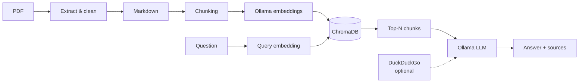

# LLM Local

A local RAG (Retrieval Augmented Generation) pipeline for processing PDF documents and querying them using local LLMs. Converts PDFs to vector embeddings and generates concise answers using Ollama.

  

## Table of Contents

- [Overview](#overview)
- [Features](#features)
- [Project Structure](#project-structure)
- [Installation](#installation)
- [Choosing an Interface](#choosing-an-interface)
- [Quick Start](#quick-start)
- [API Reference (Python modules)](#api-reference-python-modules)
- [Configuration](#configuration)
- [Troubleshooting](#troubleshooting)
- [Data Directories](#data-directories)
- [Dependencies](#dependencies)
- [Roadmap](#roadmap)
- [Contributing](#contributing)
- [Development Notes](#development-notes)

## Overview

This project provides a complete pipeline for:

1. **PDF Extraction**: Convert PDF documents to raw text
2. **Text Processing**: Clean, normalize, and convert text to Markdown format
3. **Semantic Chunking**: Split Markdown content into semantically meaningful chunks
4. **Embedding Generation**: Generate vector embeddings using local Ollama models
5. **Vector Storage**: Persist embeddings in ChromaDB for semantic search
6. **Answer Generation**: Synthesize concise answers from retrieved chunks using local LLMs
7. **Optional Web Search**: Augment answers with internet search (privacy-aware)



## Features

<details>
<summary><b>Show full feature list</b></summary>

- 📄 **PDF Text Extraction** using `pdfminer-six`
- 🧹 **Intelligent Text Cleaning**:
  - Page number removal (footer numbers, "Page X" patterns)
  - Date removal (MM/YYYY format)
  - App/system name filtering (all-caps lines)
  - Hyphenation fixing
  - Whitespace normalization
- 📝 **Markdown Conversion**:
  - Automatic heading detection (ALL CAPS → ## , Title Case → ###)
  - Bullet point standardization
  - List formatting
- 🔀 **Smart Chunking**:
  - Heading-aware section splitting
  - Configurable chunk size and overlap
  - Semantic preservation of document structure
- 🧠 **Local Embeddings**:
  - Ollama integration for vector embeddings
  - Default: `nomic-embed-text` (768 dimensions)
  - No cloud dependencies
- 🗄️ **Vector Store (ChromaDB)**:
  - Persistent local storage
  - Semantic similarity search
  - Metadata filtering support
  - HNSW indexing for fast retrieval
  - No separate server needed - runs embedded
- 🤖 **Answer Generation**:
  - Local LLM synthesis using Ollama (llama3.1:8b)
  - Concise, coherent answers from retrieved chunks
  - No external API calls - 100% local
- 🌐 **Optional Web Search**:
  - DuckDuckGo integration for internet augmentation
  - Privacy warnings and opt-in only
  - Clear labeling of local vs web sources
- 🎯 **Modern CLI**:
  - Typer-powered command-line interface
  - Three commands: `build`, `query`, `interactive`
  - Duplicate detection with `--force` override
  - Rich console output with colors and formatting
- 🌍 **Web API (FastAPI)**:
  - RESTful endpoints for document upload, querying, and collection management
  - Background PDF processing with job tracking
  - Auto-generated interactive docs (Swagger UI at `/docs`)
  - CORS support for frontend integration
  - Pydantic request/response validation
- 💾 **JSONL Output**: Save chunks with heading context for RAG pipelines

</details>

## Project Structure

<details>
<summary><b>Show directory tree</b></summary>

```
LLM_Local/
├── src/
│   ├── __init__.py
│   ├── data_extract/              # PDF to Markdown pipeline
│   │   ├── __init__.py
│   │   ├── pdf_loader.py         # PDF text extraction
│   │   ├── markdown_converter.py  # Text to Markdown conversion
│   │   └── text_cleaning.py      # Text normalization & formatting
│   ├── rag/                        # RAG pipeline components
│   │   ├── __init__.py
│   │   ├── chunking.py            # Markdown-aware chunking logic
│   │   ├── chunking_utils.py      # JSONL save utilities
│   │   ├── embeddings.py          # Embedding generation via local Ollama
│   │   ├── vectorstore.py         # ChromaDB + answer generation
│   │   └── web_search.py          # Optional web search (DuckDuckGo)
│   └── api/                        # FastAPI web API
│       ├── app.py                 # Main FastAPI application & middleware
│       ├── models.py              # Pydantic request/response models
│       ├── dependencies.py        # Shared config, job tracking, ChromaDB client
│       └── routes/
│           ├── documents.py       # PDF upload & background processing
│           ├── query.py           # RAG query endpoint
│           └── collections.py     # Collection management endpoints
├── rag_cli.py                      # CLI application
├── api_server.py                   # API server entry point
├── data_raw/ data_processed/       # Input PDFs / generated Markdown
├── json_chunks/ chroma_db/         # Chunks (JSONL) / vector store
├── uploads/                        # Files uploaded via the API
├── docs/                           # Extra documentation
├── pyproject.toml                  # Project metadata & dependencies
├── uv.lock                         # Locked dependencies (uv)
├── requirements.txt                # pip-compatible dependency list
├── CONTRIBUTING.md                 # Contribution guidelines
├── .gitignore                      # Git ignore rules
├── .python-version                 # Python version spec
└── README.md                       # This file
```

</details>

## Installation

### Prerequisites
- Python 3.12+
- pip or uv package manager
- **Ollama** (for embeddings and generation) - [Install Ollama](https://ollama.ai/)
  - Pull the embedding model: `ollama pull nomic-embed-text`
  - Pull the generation model: `ollama pull llama3.1:8b`

### Setup

1. **Clone the repository**:
   ```bash
   git clone <repository-url>
   cd LLM_Local
   ```

2. **Create the environment and install dependencies** (recommended: `uv`):

   This project ships a `pyproject.toml` and `uv.lock`, so [`uv`](https://docs.astral.sh/uv/) is the recommended way to set things up — it creates the `.venv` and installs all locked dependencies in one step:

   ```bash
   uv sync
   ```

   This creates a `.venv` folder and installs every dependency pinned in `uv.lock`, ensuring a reproducible environment.

   You generally **don't need to manually activate** the environment — just prefix commands with `uv run`:

   ```bash
   uv run python api_server.py
   uv run python rag_cli.py query "How do I reset a password?"
   ```

   If you prefer to activate the environment explicitly (e.g. to run `python` directly):
   ```bash
   # On Windows (PowerShell):
   .venv\Scripts\Activate.ps1
   # On Windows (cmd.exe):
   .venv\Scripts\activate.bat
   # On macOS/Linux:
   source .venv/bin/activate
   ```

   To add a new dependency later, use `uv add <package>` (updates `pyproject.toml` and `uv.lock` automatically) instead of editing the files by hand.

   **Alternative: plain `venv` + `pip`** (if you don't want to use `uv`):
   ```bash
   python -m venv .venv
   # On Windows:
   .venv\Scripts\activate
   # On macOS/Linux:
   source .venv/bin/activate

   pip install -r requirements.txt
   ```


## Choosing an Interface

The pipeline can be used in three ways. All share the same core code (`src/`) and the same ChromaDB store (`./chroma_db`).

| | **CLI** (`rag_cli.py`) | **REST API** (`api_server.py`) | **Python import** |
|---|---|---|---|
| Best for | Local/admin use, batch builds, scripting | Apps, frontends, multi-user/remote access | Notebooks, custom pipelines |
| Start | `python rag_cli.py <command>` | `python api_server.py` | `from src.rag... import ...` |
| Upload PDF | `build file.pdf` (synchronous) | `POST /api/v1/documents` (background job) | `load_pdf` + `embed_chunks` + `build_vectorstore` |
| Ask question | `query "..."` / `interactive` | `POST /api/v1/query` | `query_and_generate()` |
| Manage collections | – | `GET/DELETE /api/v1/collections` | ChromaDB client |
| Duplicate detection / `--force` | ✅ | ❌ (not yet) | ❌ |
| Output | Terminal (Rich) | JSON + sources + timing | Python objects |
| Interactive docs | – | Swagger UI at `/docs` | – |

**Recommendation**
- **API = primary interface** for anything used by other programs or people.
- **CLI = admin/dev tool** for quick local tests, bulk ingestion and interactive chat; it is the only place with duplicate detection.

> ⚠️ Both interfaces write to the same `chroma_db/` directory. Avoid running a CLI `build` while the API is ingesting into the same collection.

### Minimal workflow

**CLI**
```bash
python rag_cli.py build doc.pdf
python rag_cli.py query "How do I reset a password?"
```

**FastAPI**
```bash
python api_server.py   # start server (separate terminal)
curl -X POST http://localhost:8000/api/v1/documents -F "file=@doc.pdf"
curl -X POST http://localhost:8000/api/v1/query -H "Content-Type: application/json" -d '{"question":"How do I reset a password?"}'
```

## Quick Start

<details>
<summary><b>CLI Usage</b></summary>

The project provides a modern CLI powered by **Typer** for easy interaction with the RAG pipeline.

#### 1. Build Vector Store from PDF

Process a PDF and build the vector store in one command:

```bash
python rag_cli.py build path/to/document.pdf
```

**Options:**
```bash
python rag_cli.py build document.pdf --help

# Common options:
--collection-name TEXT    # ChromaDB collection name (default: "product_docs")
--persist-dir TEXT        # ChromaDB directory (default: "./chroma_db")
--max-chunk-size INTEGER  # Max chunk size in chars (default: 1000)
--overlap INTEGER         # Overlap between chunks (default: 100)
--force / -f              # Force rebuild if already processed
```

**Duplicate Detection**: The CLI automatically detects if a PDF was already processed and prevents re-processing:

```bash
$ python rag_cli.py build document.pdf
⚠ Warning: This PDF appears to have been processed already.
Existing file: ./json_chunks/document_embedded.jsonl

Use --force to rebuild:
  python rag_cli.py build "document.pdf" --force
```

To force a rebuild:
```bash
python rag_cli.py build document.pdf --force
```

#### 2. Query the Vector Store

Ask questions and get AI-generated answers from your documents:

```bash
python rag_cli.py query "How do I reset a password?"
```

This retrieves relevant chunks from your local documents and synthesizes a concise answer using **llama3.1:8b**.

**Options:**
```bash
--collection-name TEXT    # Collection to query (default: "product_docs")
--persist-dir TEXT        # ChromaDB directory (default: "./chroma_db")
--n-results INTEGER       # Number of chunks to retrieve (default: 5)
--model TEXT              # Ollama model for generation (default: "llama3.1:8b")
--web-search              # ⚠️ Augment with web search (sends query to DuckDuckGo)
```

**Example with options:**
```bash
python rag_cli.py query "What is OAuth 2.0?" --n-results 3 --model mistral
```

**Web Search (Privacy Warning):**
```bash
# ⚠️ WARNING: Sends your query to DuckDuckGo servers
# Only use for generic, non-sensitive questions
python rag_cli.py query "What are JWT best practices?" --web-search
```

When `--web-search` is enabled:
- ✅ Your local documents are searched first
- ✅ Web results are added as supplementary context
- ✅ Answer clearly indicates sources (local docs vs web)
- ⚠️ **Privacy risk**: Query text is sent to DuckDuckGo
- ⚠️ **DO NOT use** for internal/confidential questions

#### 3. Interactive Q&A Mode

Start an interactive session to ask multiple questions:

```bash
python rag_cli.py interactive
```

```
Interactive Q&A Mode
Collection: 'product_docs' at './chroma_db'
Type 'quit' or 'exit' to stop.

❓ Your question: How do I configure the system?

Generating answer...

Answer:
To configure the system, navigate to Settings > Configuration...
[AI-generated concise answer based on your documents]

❓ Your question: What are the prerequisites?

Generating answer...

Answer:
The prerequisites include Python 3.12+, Ollama...
[AI-generated concise answer]

❓ Your question: quit
Goodbye!
```

**Options:**
```bash
--collection-name TEXT  # Collection to query (default: "product_docs")
--persist-dir TEXT      # ChromaDB directory (default: "./chroma_db")
--n-results INTEGER     # Results per query (default: 3)
--model TEXT            # Ollama model (default: "llama3.1:8b")
--web-search            # ⚠️ Enable web search (privacy warning applies)
```

**Interactive with web search:**
```bash
# ⚠️ WARNING: ALL queries in this session will be sent to DuckDuckGo
python rag_cli.py interactive --web-search
```

</details>

<details>
<summary><b>CLI Examples (common workflows)</b></summary>

**1. Process a new PDF document:**
```bash
python rag_cli.py build "C:/Documents/UserManual.pdf"
```

**2. Process with custom chunking parameters:**
```bash
python rag_cli.py build document.pdf --max-chunk-size 1500 --overlap 150
```

**3. Query your documents:**
```bash
python rag_cli.py query "How do I install the software?"
```

**4. Query with web search augmentation:**
```bash
# ⚠️ Only for generic questions - sends query to DuckDuckGo
python rag_cli.py query "What are OAuth 2.0 best practices?" --web-search
```

**5. Use multiple collections for different document sets:**
```bash
# Build a collection for technical docs
python rag_cli.py build tech_manual.pdf --collection-name tech_docs

# Build a collection for user guides
python rag_cli.py build user_guide.pdf --collection-name user_docs

# Query specific collection
python rag_cli.py query "API endpoints" --collection-name tech_docs
```

**6. Force rebuild after document update:**
```bash
python rag_cli.py build updated_manual.pdf --force
```

**7. Interactive exploration:**
```bash
python rag_cli.py interactive --n-results 5
```

**8. Interactive with different LLM model:**
```bash
python rag_cli.py interactive --model mistral
```

</details>

<details>
<summary><b>Programmatic Usage (Python import)</b></summary>

For advanced use cases, you can use the Python API directly:

```python
from src.data_extract.pdf_loader import load_pdf
from src.data_extract.markdown_converter import pdf_text_to_markdown
from src.rag.chunking import markdown_chunker
from src.rag.chunking_utils import save_chunks_to_jsonl
from src.rag.embeddings import embed_chunks
from src.rag.vectorstore import build_vectorstore, query_and_generate

# 1. Extract text from PDF
pdf_path = "path/to/document.pdf"
raw_text = load_pdf(pdf_path)

# 2. Convert to Markdown
markdown_text = pdf_text_to_markdown(raw_text)

# 3. Create semantic chunks
chunks = markdown_chunker(markdown_text, max_chunk_size=1000, overlap=100)

# 4. Save as JSONL
save_chunks_to_jsonl(chunks, "output/chunks.jsonl")

# 5. Generate embeddings (requires Ollama running locally)
embedded_chunks = embed_chunks(chunks, model="nomic-embed-text")

# 6. Store in ChromaDB vector store
build_vectorstore(
    embedded_chunks,
    collection_name="my_docs",
    persist_dir="./chroma_db"
)

# 7. Query and generate answer
answer = query_and_generate(
    query_text="How do I reset a password?",
    collection_name="my_docs",
    n_results=5,
    generation_model="llama3.1:8b",
    use_web_search=False  # Set to True to enable web search
)

print(answer)
```

</details>

<details open>
<summary><b>Web API Usage (FastAPI)</b></summary>

The project also exposes the RAG pipeline as a REST API powered by **FastAPI**.

#### Start the API Server

```bash
python api_server.py
```

The server starts at `http://localhost:8000` by default. Configure with environment variables:

| Variable | Default | Description |
|---|---|---|
| `API_HOST` | `0.0.0.0` | Server bind address |
| `API_PORT` | `8000` | Server port |
| `API_RELOAD` | `true` | Auto-reload on code changes (set `false` in production) |

Interactive API documentation is auto-generated at:
- **Swagger UI**: [http://localhost:8000/docs](http://localhost:8000/docs)
- **ReDoc**: [http://localhost:8000/redoc](http://localhost:8000/redoc)

#### API Endpoints

##### Health Check

```bash
GET /health
```

```bash
curl http://localhost:8000/health
# {"status": "healthy", "service": "LLM Local RAG API", "version": "0.1.0", ...}
```

##### Upload a Document

Upload a PDF for background processing into the vector store.

```bash
POST /api/v1/documents
```

```bash
curl -X POST http://localhost:8000/api/v1/documents \
  -F "file=@path/to/document.pdf" \
  -F "collection_name=my_docs"
```

**Response** (HTTP 202 Accepted):
```json
{
  "job_id": "a1b2c3d4-...",
  "status": "queued",
  "message": "Document accepted and queued for processing.",
  "filename": "document.pdf"
}
```

**Constraints:**
- File must be `.pdf`
- Maximum file size: 50 MB

##### Check Processing Status

```bash
GET /api/v1/documents/{job_id}
```

```bash
curl http://localhost:8000/api/v1/documents/a1b2c3d4-...
```

**Response:**
```json
{
  "job_id": "a1b2c3d4-...",
  "status": "completed",
  "progress": 100,
  "error": null,
  "collection_name": "my_docs"
}
```

Status values: `pending` → `processing` → `completed` | `failed`

##### Query Documents

Ask a question and get an AI-generated answer from your documents.

```bash
POST /api/v1/query
```

```bash
curl -X POST http://localhost:8000/api/v1/query \
  -H "Content-Type: application/json" \
  -d '{
    "question": "How do I reset a password?",
    "collection_name": "product_docs",
    "n_results": 5,
    "web_search": false
  }'
```

**Response:**
```json
{
  "answer": "To reset a password, navigate to Settings > User Management...",
  "sources": [
    {"text": "...", "heading": "Password Reset", "distance": 0.32}
  ],
  "processing_time": 2.45,
  "used_web_search": false
}
```

**Request fields:**
| Field | Type | Default | Description |
|---|---|---|---|
| `question` | string | *required* | The question to ask |
| `collection_name` | string | `"product_docs"` | ChromaDB collection to query |
| `n_results` | int (1-50) | `5` | Number of chunks to retrieve |
| `web_search` | bool | `false` | ⚠️ Enable web search (sends query to DuckDuckGo) |

##### List Collections

```bash
GET /api/v1/collections
```

```bash
curl http://localhost:8000/api/v1/collections
```

**Response:**
```json
[
  {"name": "product_docs", "document_count": 42, "created_at": null},
  {"name": "tech_docs", "document_count": 15, "created_at": null}
]
```

##### Delete a Collection

```bash
DELETE /api/v1/collections/{name}
```

```bash
curl -X DELETE http://localhost:8000/api/v1/collections/test_collection
# {"message": "Collection 'test_collection' deleted successfully."}
```

> **Safety:** The default collection (`product_docs`) cannot be deleted via the API (returns 403).

#### API Error Codes

| Code | Meaning |
|---|---|
| 400 | Invalid file type or empty upload |
| 403 | Attempted to delete the default collection |
| 404 | Collection or job not found |
| 413 | File exceeds 50 MB size limit |
| 422 | Request validation error (auto from Pydantic) |
| 503 | Ollama service unavailable |

</details>

## API Reference (Python modules)

<details>
<summary><b>Expand module reference</b></summary>

### Data Extract Module

#### `load_pdf(path: str) -> str`
Extracts text from a PDF file.

**Parameters:**
- `path` (str): Path to the PDF file

**Returns:**
- str: Extracted text content

---

#### `pdf_text_to_markdown(raw_text: str) -> str`
Converts raw text to Markdown format.

**Parameters:**
- `raw_text` (str): Raw extracted text

**Returns:**
- str: Markdown-formatted text

---

#### Text Cleaning Functions

- `normalize_text(text: str) -> str`: Normalize text (remove page numbers, dates, app names, fix hyphens)
- `convert_lists(text: str) -> str`: Convert bullet points to Markdown lists
- `convert_headings(text: str) -> str`: Convert text to Markdown headings

**Enhanced text cleaning includes:**
- Standalone page numbers (e.g., `102` in footer)
- Date patterns (e.g., `02/2021`)
- App/system names in all-caps (e.g., `Product Portal`)

### RAG Module

#### `markdown_chunker(md_text: str, max_chunk_size: int = 1000, overlap: int = 100) -> List[Dict]`
Main chunking function for semantic splitting.

**Parameters:**
- `md_text` (str): Markdown text to chunk
- `max_chunk_size` (int): Maximum characters per chunk (default: 1000)
- `overlap` (int): Character overlap between chunks (default: 100)

**Returns:**
- List[Dict]: Chunks with structure `{"text": str, "heading": str}`

---

#### `save_chunks_to_jsonl(chunks: List[Dict], output_path: str)`
Saves chunks to JSONL format.

**Parameters:**
- `chunks` (List[Dict]): List of chunk dictionaries
- `output_path` (str): Output file path

---

#### `get_embedding(text: str, model: str = "nomic-embed-text") -> List[float]`
Generates a vector embedding for a single text string using a local Ollama model.

**Parameters:**
- `text` (str): Input text to embed
- `model` (str): Ollama embedding model name (default: `"nomic-embed-text"`)

**Returns:**
- `List[float]`: The embedding vector

**Recommended models** (pull with `ollama pull <model>` before use):
- `nomic-embed-text` — fast, 768-dim, good for most RAG use cases
- `mxbai-embed-large` — higher quality, 1024-dim, better retrieval scores

> ⚠️ Use a **dedicated embedding model**, not a generative model like `llama3.1:8b`.

---

#### `embed_chunks(chunks: List[Dict], model: str = "nomic-embed-text") -> List[Dict]`
Adds an `"embedding"` field to each chunk dict and returns the enriched list.

**Parameters:**
- `chunks` (List[Dict]): Chunk dicts from `markdown_chunker()` — `{"text": str, "heading": str}`
- `model` (str): Ollama embedding model name (default: `"nomic-embed-text"`)

**Returns:**
- `List[Dict]`: Same list with `"embedding": List[float]` added to every chunk

---

#### `build_vectorstore(embedded_chunks: List[Dict], collection_name: str = "product_docs", persist_dir: str = "./chroma_db")`
Stores embedded chunks in a persistent ChromaDB collection.

**Parameters:**
- `embedded_chunks` (List[Dict]): Chunks with embeddings from `embed_chunks()`
- `collection_name` (str): Name of the ChromaDB collection (default: `"product_docs"`)
- `persist_dir` (str): Directory for ChromaDB persistence (default: `"./chroma_db"`)

**Features:**
- Idempotent upserts — safe to call repeatedly
- Automatic persistence — survives restarts
- Stores text, embeddings, and metadata (`heading`)

---

#### `query_vectorstore(query_text: str, collection_name: str = "product_docs", persist_dir: str = "./chroma_db", n_results: int = 5, model: str = "nomic-embed-text") -> List[Dict]`
Performs semantic search on the vector store.

**Parameters:**
- `query_text` (str): Natural language question or search phrase
- `collection_name` (str): ChromaDB collection name (default: `"product_docs"`)
- `persist_dir` (str): Directory where ChromaDB data is stored (default: `"./chroma_db"`)
- `n_results` (int): Number of top results to return (default: 5)
- `model` (str): Ollama model for query embedding (default: `"nomic-embed-text"`)

**Returns:**
- `List[Dict]`: Results sorted by similarity, each containing:
  - `"text"` (str): Chunk text
  - `"heading"` (str): Section heading
  - `"distance"` (float): Similarity distance (lower = more similar)

**Example:**
```python
results = query_vectorstore(
    query_text="How do I reset a password?",
    n_results=3
)
# Returns chunks most similar to the query
```

---

#### `query_and_generate(query_text: str, collection_name: str = "product_docs", persist_dir: str = "./chroma_db", n_results: int = 5, embed_model: str = "nomic-embed-text", generation_model: str = "llama3.1:8b", use_web_search: bool = False) -> str`
Retrieves relevant chunks and generates a concise answer using a local LLM.

**Parameters:**
- `query_text` (str): Natural language question
- `collection_name` (str): ChromaDB collection name (default: `"product_docs"`)
- `persist_dir` (str): Directory where ChromaDB data is stored (default: `"./chroma_db"`)
- `n_results` (int): Number of chunks to retrieve for context (default: 5)
- `embed_model` (str): Ollama model for query embedding (default: `"nomic-embed-text"`)
- `generation_model` (str): Ollama model for answer generation (default: `"llama3.1:8b"`)
- `use_web_search` (bool): If True, augment with web search ⚠️ (default: False)

**Returns:**
- `str`: Concise answer synthesized from retrieved chunks

**Features:**
- Retrieves relevant chunks from local ChromaDB
- Optionally augments with DuckDuckGo web search
- Synthesizes coherent answer using local LLM
- Clear source labeling (local docs vs web)

**Example:**
```python
answer = query_and_generate(
    query_text="How does JWT authentication work?",
    n_results=5,
    generation_model="llama3.1:8b",
    use_web_search=False  # Set to True for web augmentation
)
print(answer)
```

**⚠️ Privacy Warning for Web Search:**
When `use_web_search=True`, your query is sent to DuckDuckGo servers. Only use for generic, non-sensitive questions.

---

#### `search_web(query: str, max_results: int = 3) -> List[Dict]`
Searches the web using DuckDuckGo (optional, privacy-aware).

**Parameters:**
- `query` (str): Search query
- `max_results` (int): Maximum number of results (default: 3)

**Returns:**
- `List[Dict]`: Each dict contains `{"text": str, "source": str}`

**⚠️ Privacy Warning:**
This function sends your query to DuckDuckGo servers. Do NOT use for sensitive/internal questions.

</details>

---

## Configuration

<details>
<summary><b>Chunking, vector store and distance settings</b></summary>

### Chunking Parameters

Adjust these in `rag_cli.py` or when calling `markdown_chunker()`:

- **max_chunk_size**: Size threshold (characters) for splitting chunks
  - Smaller values: More granular, more chunks
  - Larger values: Coarser, fewer chunks
  
- **overlap**: Character overlap between consecutive chunks
  - Prevents loss of context at chunk boundaries
  - Typical: 10-20% of max_chunk_size

### Vector Store Parameters

Configure these when calling `build_vectorstore()` and `query_vectorstore()`:

- **collection_name**: Name of the ChromaDB collection
  - Use different names for different document sets
  - Default: `"product_docs"`

- **persist_dir**: Directory for ChromaDB persistence
  - ChromaDB stores all data here
  - Default: `"./chroma_db"`
  - Add to `.gitignore`

- **n_results**: Number of results to retrieve in queries
  - Too low: might miss relevant context
  - Too high: might include irrelevant noise
  - Recommended: 3-7 for most RAG use cases

- **model**: Embedding model name
  - Must be consistent between indexing and querying
  - Default: `"nomic-embed-text"` (768 dimensions)
  - Alternative: `"mxbai-embed-large"` (1024 dimensions, better quality)

### Distance Interpretation

Query results include a `distance` score:
- **< 0.5**: Strong semantic match (highly relevant)
- **0.5 - 1.0**: Moderate match (potentially useful)
- **> 1.0**: Weak match (consider filtering out)

</details>

## Troubleshooting

| Symptom | Likely cause / fix |
|---|---|
| API returns **503** / CLI connection error | Ollama is not running. Start it and verify with `ollama list`. |
| `model not found` | Pull it: `ollama pull nomic-embed-text` and `ollama pull llama3.1:8b`. |
| Embedding dimension mismatch | Embedding model changed after indexing. Use the same model for build and query, or rebuild the collection. |
| `build` says PDF already processed | Use `--force` (CLI). The API has no duplicate check yet. |
| Empty or poor answers | Raise `--n-results` / `n_results`; check `distance` values (see [Distance Interpretation](#distance-interpretation)). |
| `database is locked` / odd Chroma state | Avoid running CLI `build` and API ingestion on the same `chroma_db/` at the same time. |
| Port already in use | Set `API_PORT` to another value. |

## Data Directories

- `data_raw/`: Place raw PDF files here (ignored by git)
- `data_processed/`: Output markdown files (ignored by git)
- `json_chunks/`: Generated JSONL chunks (ignored by git)
- `chroma_db/`: ChromaDB vector store persistence (ignored by git, auto-created)

## Dependencies

Dependencies and exact versions are defined in `pyproject.toml` / `uv.lock` (and `requirements.txt` for pip).

**Core packages:** `pdfminer-six` (PDF extraction), `ollama` (embeddings + generation), `chromadb` (vector store), `typer` + `rich` (CLI), `fastapi` + `uvicorn` + `python-multipart` (API), `ddgs` (optional web search).

**External service:** [Ollama](https://ollama.ai/) running locally, with the models listed in [Prerequisites](#prerequisites).

## Roadmap

- [x] **Embeddings Module**: Local embedding generation via Ollama (`nomic-embed-text` / `mxbai-embed-large`)
- [x] **Vector Store**: ChromaDB integration with persistent storage
- [x] **CLI Interface**: Typer-based CLI with build, query, and interactive modes
- [x] **Duplicate Detection**: Automatic detection of already-processed PDFs
- [ ] **LangChain Integration**: Seamless RAG pipeline
  - Currently this RAG pipeline uses direct Ollama API calls and custom logic. LangChain is a framework that provides:
    - Pre-built RAG chains (retrieval + generation pipelines)
    - Memory management for conversational context
    - Agent capabilities for complex reasoning
    - Standardized interfaces for LLMs, vector stores, embeddings 
  - Replace custom `query_and_generate()` with LangChain's `RetrievalQA` or `ConversationalRetrievalChain`
  - Use `OllamaEmbeddings` wrapper instead of direct API calls
  - Use `Chroma` LangChain wrapper for vectorstore
  - Add conversation memory for multi-turn dialogues
  - Enable prompt templates for better control
  - Benefits: Less custom code, advanced features (agents, multi-query retrieval), better conversation handling
  - Complexity: Medium (refactoring existing code)
- [x] **Web API**: FastAPI endpoint for document processing
  - RESTful API with endpoints for document upload, querying, and collection management
  - Background PDF processing with job tracking and progress reporting
  - CORS support for frontend access
  - Pydantic request/response validation
  - Auto-generated interactive docs (Swagger UI)
  - Singleton ChromaDB client for efficient connection reuse
  - TTL-based job cleanup (24h expiry)
- [ ] **API duplicate detection**: Reuse the CLI's already-processed check in `POST /api/v1/documents`
- [ ] **Docker Support**: Containerized deployment (Dockerfile + compose with Ollama)
- [ ] **Testing Suite**: Unit and integration tests (pytest, FastAPI `TestClient`)
- [ ] **Documentation**: Extended guides and examples

## Known Issues & TODOs

1. **Improve text cleaning**: ✅
2. **Error Handling**: Could be enhanced for edge cases (malformed PDFs, network issues)
3. **Type Hints**: Could be enhanced with more specific return types
4. **Batch Processing**: Add support for processing multiple PDFs in one command

## Contributing

Contributions are welcome! See [CONTRIBUTING.md](CONTRIBUTING.md) for details. In short: create a feature branch, make your changes, test thoroughly, and open a pull request.

## License

No license has been chosen yet. <!-- TODO: add a LICENSE file (e.g. MIT / Apache-2.0) and reference it here -->

## Development Notes

- **Python**: 3.12+ (see `.python-version` and `pyproject.toml`)
- **Environment**: managed with `uv` — `uv sync`, run with `uv run python <script>.py`, add packages with `uv add <package>`
- **Code style**: PEP 8, type hints for public APIs, docstrings on all functions and modules

