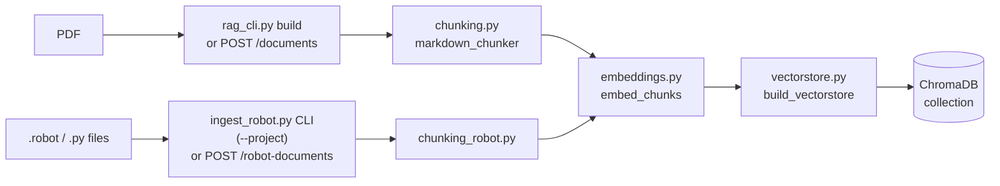
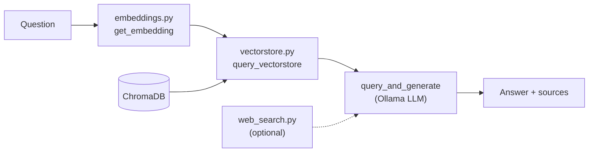

## `src/rag` – chunking, embeddings, vector store, retrieval

Core RAG logic: turn documents into chunks, embed them (local Ollama), store them in ChromaDB, then retrieve and
generate answers. It is used by `rag_cli.py` and the FastAPI app in `src/api`.

### File structure

```
src/rag/
├── __init__.py          # Public exports: markdown_chunker, split_markdown_by_headings, chunk_section, save_chunks_to_jsonl
├── chunking.py          # Markdown chunker (split by headings, then by size with overlap)
├── chunking_robot.py    # Chunker for Robot Framework / Python library files (one keyword/test/function = one chunk)
├── chunking_utils.py    # save_chunks_to_jsonl() – dump chunks to a JSONL file
├── embeddings.py        # get_embedding(), embed_chunks() – Ollama embedding model (default: nomic-embed-text)
├── vectorstore.py       # build_vectorstore(), query_vectorstore(), query_and_generate() – ChromaDB (persistent client)
├── ingest_robot.py      # CLI + helpers to ingest code files (collect, dedupe, chunk, embed, store)
├── web_search.py        # search_web() – optional DuckDuckGo context (queries leave the machine!)
└── VECTORE_STORE.md     # Detailed vector store / ChromaDB guide
```

### Module overview

| Module | Main functions | Notes |
|--------|----------------|-------|
| `chunking.py` | `markdown_chunker`, `split_markdown_by_headings`, `chunk_section` | Defaults: `max_chunk_size=1000`, `overlap=100` (characters) |
| `chunking_robot.py` | `chunk_robot_file`, `chunk_python_file` | `project` metadata is required and validated; metadata values are scalars only |
| `chunking_utils.py` | `save_chunks_to_jsonl` | Creates the output directory if needed |
| `embeddings.py` | `get_embedding`, `embed_chunks` | Use an embedding model, not a generative one |
| `vectorstore.py` | `build_vectorstore`, `query_vectorstore`, `query_and_generate` | Defaults: collection `product_docs`, dir `./chroma_db`, generation model `llama3.1:8b` |
| `ingest_robot.py` | `collect_files`, `check_duplicates`, `chunk_file`, `embed_and_store`, `main` | Shared by the CLI and the API upload route |
| `web_search.py` | `search_web` | Used only when `use_web_search=True` |

### Pipelines

Both ingestion paths share the same last steps (embed → store); they differ only in the front door and the chunker.
- The Robot path has two front doors: 
  - the `ingest_robot.py` CLI (folders/files) 
  - and the `POST /api/v1/robot-documents` upload route, which reuses `chunk_file` / `embed_and_store` from `ingest_robot.py`
- The PDF path has two front doors:
  - the `rag_cli.py build` CLI (PDF file)
  - and the `POST /api/v1/documents` upload route, which reuses `markdown_chunker` / `embed_chunks` / `build_vectorstore`



Query flow:



### Usage

The modules in this folder are not run directly (except `ingest_robot.py`); they are called from three entry points,
all run from the repository root: the CLI (`rag_cli.py`), the REST API (`api_server.py`), or your own Python code.

#### 1. CLI – `rag_cli.py` (Typer)

```powershell
# Ingest a PDF: PDF -> markdown -> chunking.py -> embeddings.py -> vectorstore.build_vectorstore
python rag_cli.py build path\to\file.pdf --collection-name product_docs --max-chunk-size 1000 --overlap 100
python rag_cli.py build path\to\file.pdf --force          # reprocess an already ingested file

# Ask one question: vectorstore.query_and_generate
python rag_cli.py query "How do I ...?" --collection-name product_docs --n-results 5
python rag_cli.py query "How do I ...?" --web-search      # sends the query to DuckDuckGo!

# Interactive question loop
python rag_cli.py interactive --collection-name product_docs
```

#### 2. CLI – `ingest_robot.py` (Robot Framework / Python library files)

```powershell
# Files and/or folders (searched recursively for .robot, .resource, .py); one --project per run
python -m src.rag.ingest_robot --project PROJECT path\to\folder
python -m src.rag.ingest_robot --project general path\to\File.robot path\to\Lib.py

# Chunk and report only; nothing is embedded or stored
python -m src.rag.ingest_robot --project PROJECT path\to\folder --dry-run

# Other collection / ChromaDB directory
python -m src.rag.ingest_robot --project PROJECT path\to\folder --collection my_collection --persist-dir .\chroma_db
```

File names must be unique within a run; `doc_id` is `{project}/{file name}`, so re-ingesting a file overwrites its
own chunks.

#### 3. REST API – `api_server.py` (FastAPI, routes under `/api/v1`)

```powershell
python api_server.py          # http://localhost:8000, interactive docs at /docs
```

```powershell
# Upload a PDF (async job, returns 202 + job_id)
curl -X POST http://localhost:8000/api/v1/documents -F "file=@file.pdf" -F "collection_name=product_docs"

# Upload a Robot/Python file (same chunking + storage as ingest_robot.py; 409 if it exists, unless force=true)
curl -X POST http://localhost:8000/api/v1/robot-documents -F "file=@File.robot" -F "project=PROJECT" -F "force=false"

# Check processing status
curl http://localhost:8000/api/v1/documents/<job_id>

# Ask a question
curl -X POST http://localhost:8000/api/v1/query -H "Content-Type: application/json" `
     -d '{"question": "How do I ...?", "collection_name": "product_docs", "n_results": 5}'

# List / delete collections
curl http://localhost:8000/api/v1/collections
curl -X DELETE http://localhost:8000/api/v1/collections/<name>
```

#### 4. From Python

```python
from src.rag.vectorstore import query_and_generate, query_vectorstore

# Retrieval + LLM answer (optionally with sources)
answer, sources = query_and_generate("How do I ...?", collection_name="product_docs", return_sources=True)

# Retrieval only (top-k chunks, no LLM)
hits = query_vectorstore("How do I ...?", collection_name="product_docs", n_results=5)
```

```python
from pathlib import Path
from src.rag.ingest_robot import chunk_file, embed_and_store

# Same two calls the API route `POST /robot-documents` makes
path = Path("path/to/File.robot")
chunks = chunk_file(path, "PROJECT")
embed_and_store(chunks, "PROJECT", path.name, "product_ast", "./chroma_db")
```

### Requirements

- Ollama running locally with an embedding model (e.g. `ollama pull nomic-embed-text`) and a generation model.
- Dependencies from the project's `requirements.txt` (ChromaDB, `ollama`, `ddgs`, Robot Framework parser).

See `VECTORE_STORE.md` for ChromaDB details.
